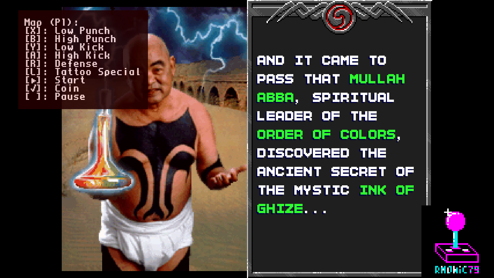
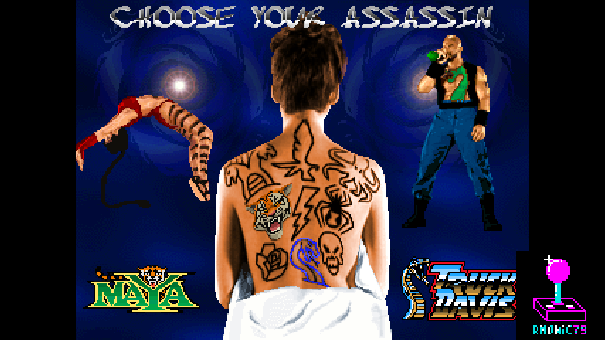
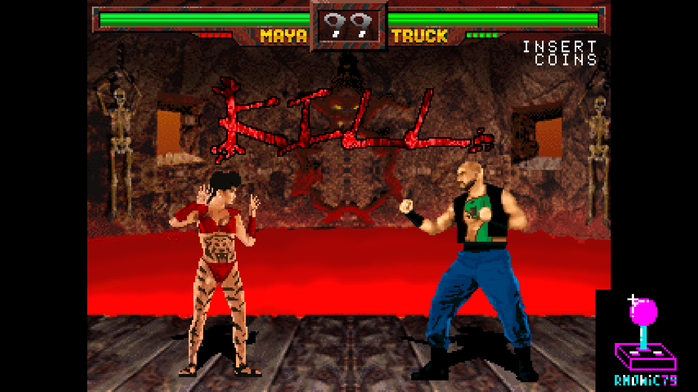
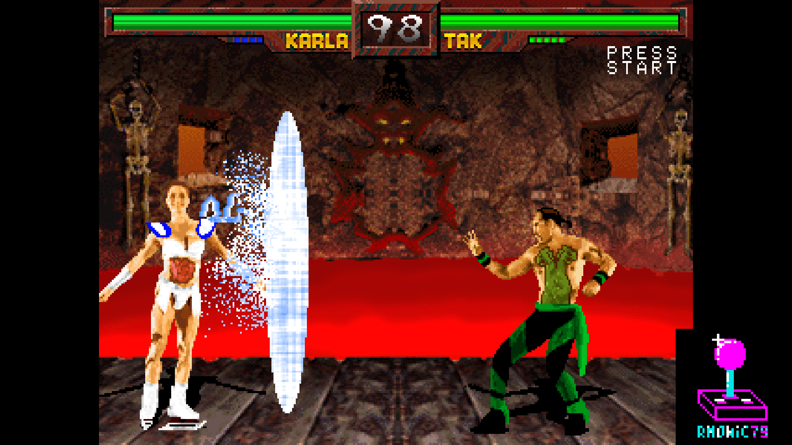
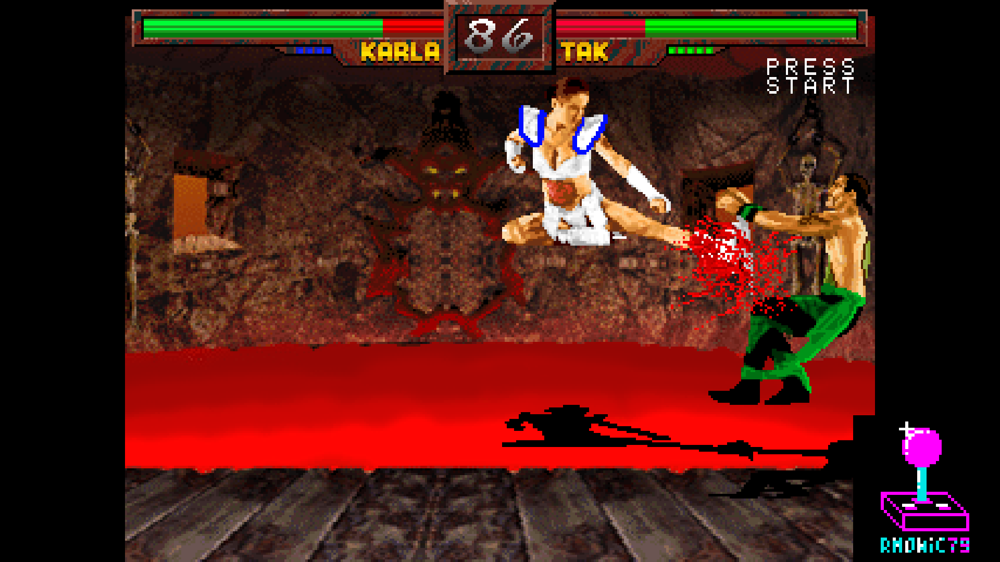
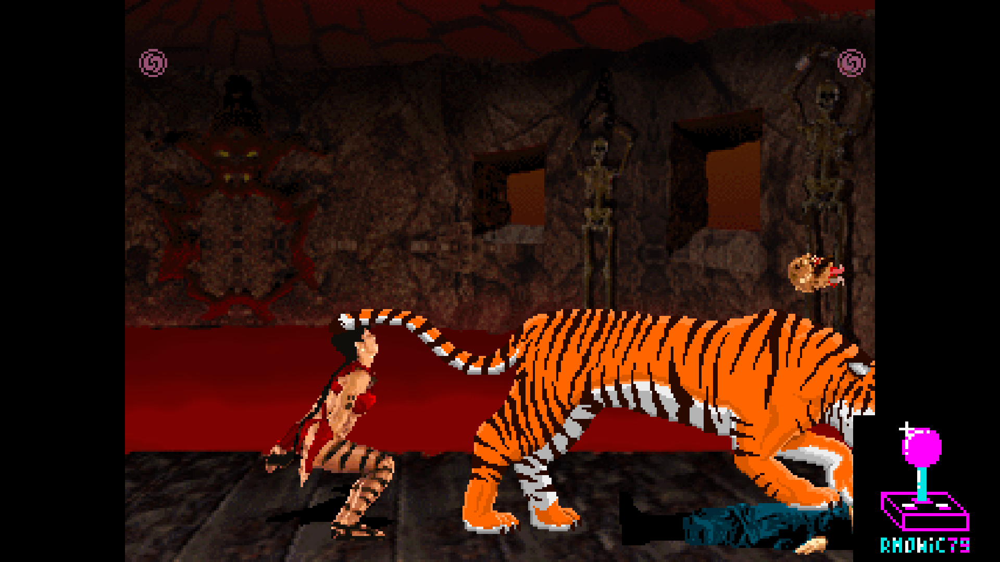
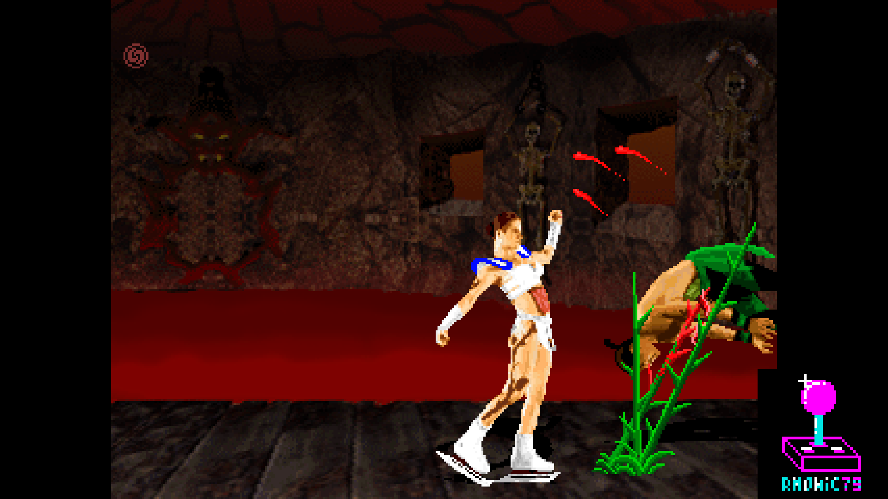

# rm-TattooAssassins_MiSTer

FPGA core for **Tattoo Assassins** (Data East Pinball, 1994) targeting the
[MiSTer FPGA](https://github.com/MiSTer-devel) platform (Terasic DE10-Nano).

Tattoo Assassins runs on Data East's **DECO 32-bit arcade hardware** — the same
family as Night Slashers — with an **encrypted ARM-based main CPU (Data East
chip 156)**, two DECO16IC tilemap chips (four scrolling playfields), two sprite
generators, the DECO ACE alpha-blend / fade mixer, DECO104 protection, a 93C46
EEPROM for the settings, and the **Data East pinball sound board**: a Motorola
68B09E driving a **BSMT2000** sample player.

This core reimplements the hardware in SystemVerilog from MAME references and
hardware observation. It grew out of the Night Slashers core, which shares the
CPU and video side; the sound board is entirely new.

---

# The `rm` version

*This section is the same in every `rm` core: it explains what the line is and
what it adds. Skip it if you already know.*

**`rm` cores are my own builds, published outside the MiSTer-devel tree.** They
are not a fork of the emulation: the core is the same one I contribute
upstream, plus two things the official tree cannot host, because both require
editing the `sys/` framework and MiSTer-devel does not take those changes.

### 1. CRT geometry that leaves HDMI alone

**CRT Adjust** (H-Size, H-Position, V-Shift) and **CRT V-Size** let you align
and size the picture on a 15 kHz tube from the OSD, with the sync left native
so the screen never loses lock, and without duplicating or dropping a single
line.

The point of the whole thing is *where* they sit: **sys-side**, in the analog
chain between the scanline stage and the OSD. The scaler taps the video
**before** that point, so **HDMI stays bit-identical while you adjust the
CRT** — you can align a tube without touching what a capture card or a
streaming setup sees. Putting the same modules inside the core would drag HDMI
along with every correction, which defeats the purpose.

V-Size offers two modes: **PVM** (retimes the lines — perfect on broadcast
monitors with a wide lock range) and **Cabinet** (native timing, photometric —
the sync stays rock-steady on arcade chassis with tight AFC).

### 2. Pause overlay

Logo, supporters list and scrolling credits, shown while the game is paused.

### Naming

| | |
|---|---|
| repository / folder | `rm-<Title>_MiSTer` |
| Quartus project and RBF | `rm<Title>` |
| MRA files | `rm <Title> (…).mra` |

The `rm` RBF has a **different file name** from the official core, so the two
can sit on the same SD card without overwriting each other, and you choose
which one to launch from the MRA.

### What the MiSTer-devel version has instead

Everything else, identically: savestates, audio work, video fixes, hardware
accuracy. What it does **not** have is the CRT geometry controls and the pause
overlay — the two items above.

---

## About the game

**Tattoo Assassins** is a one-on-one fighting game with digitized fighters,
made by Data East's pinball division in 1994. It was never released
commercially: only prototype boards exist. It is remembered for its sheer
number of finishing moves and for its tattoo-powered specials.

## Status

**Current version: 1.0** (November 2026) — the first public release.

The game boots and plays on real MiSTer hardware with video, audio and inputs.
Savestates are **enabled** (16 slots). Settings live in the emulated 93C46
EEPROM, exactly as on the board; the DIP switches of the MRA are written into
it at reset.

The main CPU is the **encrypted Data East 156 ARM processor** — the encrypted
ARM opcodes and the DECO56 tile scramble are decrypted **on board** during ROM
download, so no pre-decrypted ROMs are needed.

## What's in 1.0

**Sound**

- **The pinball sound board**: the 68B09E sound CPU (2 MHz, with E and Q in
  quadrature and the board's periodic 489 Hz FIRQ) driving a **BSMT2000**
  sample player over the 2 MB sample ROM, with the command latch and the
  "BSMT ready" handshake of the original board. The sound board stops together
  with the game in pause.

**Video**

- **Big fatality text**: the text layer (chip 0, playfield 1) switches between
  8×8 and 16×16 line by line as the game asks, with its bank, so the large
  "TATTOOED"-style captions are drawn whole.
- **512 sprites per chip**, as on the board: the GAME OVER screen, which uses
  more than 256 sprites on chip 1, is no longer cut.
- The two 8 bpp background layers are combined as the original board does.

**CPU**

- **Multiply in 2 cycles** (MUL / MLA), as the ARM in the board: the fatality
  sequences no longer pause, because the palette fade that runs between them
  now takes the time it takes on the original.
- **CPU Speed** OSD option (7.08 MHz original / 10.8 / 14.1 / 28.3 MHz).

**Inputs and settings**

- The six buttons carry the game's names in the OSD — Low Punch, High Punch,
  Low Kick, High Kick, Defense, Tattoo Special — with a default pad mapping in
  the MRA.
- DECO104 protection and the coin / start / service inputs as in MAME; full
  coinage table (22 rates) and the Service menu.

**rm**

- **CRT Adjust** and **CRT V-Size** (PVM / Cabinet), sys-side, HDMI untouched.
- Pause overlay with logo and supporters list.

**Timing**: every clock closes positive in Quartus.

## Features

- **DECO156 encrypted ARM main CPU** @ 7.0805 MHz (Amber ARMv2a core) with
  on-board opcode decrypt
- Data East pinball sound board: **68B09E** (mc6809i) + **BSMT2000**
- Two DECO16IC tilemap chips: four playfields, 16×16 and 8×8 tiles, per-row
  and per-column scroll
- DECO ACE alpha-blend / fade mixer for layer composition
- Two sprite generators, 512 sprites each, priority and flip
- DECO104 protection, 93C46 EEPROM for the settings
- On-board decrypt of the encrypted ARM CPU ROM and of the DECO56 tiles during
  ROM download — no pre-decrypted ROMs needed
- Tile ROM streaming through a 4-bank SDRAM (JTFRAME SDRAM64), sprite and sound
  ROMs backed by DDR3
- **Savestates**, 16 slots
- Refresh rate: original 57.7 Hz or 60 Hz
- VBlank-synchronized pause (frame-aligned), with a clean-pause option
- **CRT Adjust** (H-Size, H-Position, V-Shift) and **CRT V-Size** (PVM /
  Cabinet), sys-side, with HDMI bit-identical while adjusting
- MiSTer OSD with video options, **DIP switches** and **Service menu**
- Pause overlay with logo + supporters scroll

### A note on how the CRT controls work

The picture is not rescaled: every source pixel is emitted for an **integer**
number of pixel-clock periods through a line buffer, so H-Size is free of
shimmering and of scaling artifacts, and the content is byte-exact. The
horizontal sync is left **native** — the CRT keeps its lock while you resize
and slide the image, which is why nothing rolls or tears during adjustment.

V-Size does not duplicate or drop lines either: it retimes the line period and
the line count per frame so their product stays exactly one frame, spreading
the same unique lines further apart. In **Cabinet** mode it instead keeps the
native timing and redistributes light between adjacent lines in linear gamma,
so the sync never moves at all — made for arcade chassis with a tight AFC.

Both stages sit **sys-side**, after the scaler tap: HDMI is bit-identical
throughout. This is what the `rm` line exists for (see the top of this file).

## Screenshots

| | |
|---|---|
|  |  |
| Story intro, with the button map in the OSD | Character select |
|  |  |
| Maya vs Truck | Karla's tattoo special |
|  |  |
| Flying kick | Maya's tiger fatality |
|  | |
| Karla's fatality | |

## Hardware emulated

| Component        | Spec                                                      |
|------------------|-----------------------------------------------------------|
| Main CPU         | Data East 156 (encrypted ARMv2a) @ 7.0805 MHz             |
| Sound CPU        | Motorola 68B09E @ 2 MHz (mc6809i)                         |
| Sound chip       | BSMT2000 sample player, 2 MB sample ROM                   |
| Tilemaps         | DECO16IC ×2 (four playfields, 16×16 / 8×8)                |
| Sprites          | two sprite generators, 512 sprites each                   |
| Palette / mixer  | DECO ACE (palette + alpha-blend + fade)                   |
| I/O + protection | DECO104                                                   |
| Settings         | 93C46 serial EEPROM                                       |

## Hardware requirements

- Terasic DE10-Nano
- MiSTer I/O board (recommended)
- SDRAM module (32 MB or 64 MB)
- DDR3 memory (built into DE10-Nano, used for the sprite and sound ROMs)
- Works on HDMI displays and on CRTs via the analog video output

## Building from source

Requires Quartus Prime 17.0 (free Lite Edition).

```
Open rmTattooAssassins.qpf in Quartus → Processing → Start Compilation
```

Output bitstream is generated in `output_files/rmTattooAssassins.rbf`.

## Running on MiSTer

The [releases/](releases/) folder contains the MRA and a prebuilt RBF:

- `rm Tattoo Assassins (US prototype).mra`
- `rmTattooAssassins_YYYYMMDD.rbf` — prebuilt bitstream

Steps:

1. Copy the `.rbf` to `_Arcade/cores/` on the MiSTer SD card.
2. Copy the `.mra` file to `_Arcade/` on the MiSTer SD card.
3. Provide your legally-owned `tattass.zip` where the MRA expects it
   (usually in `games/mame/`).

**ROMs are NOT included in this repository.** You must provide them yourself.

## Repository layout

```
rm-TattooAssassins_MiSTer/
├── rtl/
│   ├── nightslashers/      core RTL shared with Night Slashers (video, sprites, top)
│   ├── cpu_arm/            Amber ARMv2a core + DECO156 CPU wrapper
│   ├── common/             DECO104, DECO ACE glue, decrypt, EEPROM, bridges
│   ├── sound_bsmt/         Data East pinball sound board: 68B09E + BSMT2000
│   ├── sound/              JTFRAME audio modules
│   ├── jtframe/            JTFRAME framework modules
│   ├── jtframe_sdram64*.v  SDRAM controller (JTFRAME SDRAM64)
│   └── pll/                clock PLL
├── sys/                    MiSTer framework (Sorgelig / MiSTer-devel)
├── logo/                   pause overlay assets (font, logo, supporter list)
├── docs/                   in-game screenshots
├── releases/               MRA + prebuilt RBF
├── deco56_*.hex            DECO56 decrypt tables (read at synthesis)
├── rmTattooAssassins.qpf   Quartus project
├── rmTattooAssassins.qsf   Quartus assignments
├── Template.sv             top-level wrapper
├── Template.sdc            timing constraints
├── diag_timing.tcl         timing report script (TIMEQUEST_REPORT_SCRIPT of the project)
├── build_id.v              build version stamp
└── README.md               this file
```

## Acknowledgements

- **Conor Santifort** for the **Amber** ARMv2a CPU core (OpenCores), used to
  implement the encrypted Data East 156 ARM main CPU.
- **Greg Miller** for **mc6809i**, the cycle-accurate 6809 used as the sound
  CPU.
- **Jose Tejada** ([@jotego](https://github.com/jotego)) for the JTFRAME
  framework (including SDRAM64 and the audio modules).
- **Martin Donlon** ([wickerwaka](https://github.com/wickerwaka)) for the
  savestate infrastructure, ported from the Arcade-TaitoF2 core.
- The **MAMEDev team** for the invaluable reference on the DECO16IC tilemaps,
  DECO104 protection, DECO ACE mixer, the DECO156 / DECO56 decrypt, the DECOBSMT
  sound board and the BSMT2000, memory maps and timing.
- **Sorgelig** and the **MiSTer-devel team** for the framework and Template.
- **Andrea Bogazzi** ([@asturur](https://github.com/asturur)) for help with the
  core-side Analog H-Size implementation.

## Support this project

If you enjoy this core and want to support its development:

- [Ko-fi](https://ko-fi.com/ibecerivideoludici) — one-time support
- [Patreon](https://www.patreon.com/IBeceriVideoludici) — monthly support
- [PayPal](https://www.paypal.me/IBeceriVideoludici) — one-time donation

## Follow

- [GitHub](https://github.com/rmonic79)
- [Twitch](https://twitch.tv/ibecerivideoludici) — live streams
- [YouTube](https://www.youtube.com/c/IBeceriVideoludici) — playlists and videos
- [X / Twitter](https://x.com/rmonic79)

## License

The RTL source code in this repository is provided as-is for educational
and preservation purposes under **GNU GPL v3 or later**. Original ROM data
is not included; users must provide their own legally obtained copies.

Original *Tattoo Assassins* arcade hardware © Data East, 1994.
